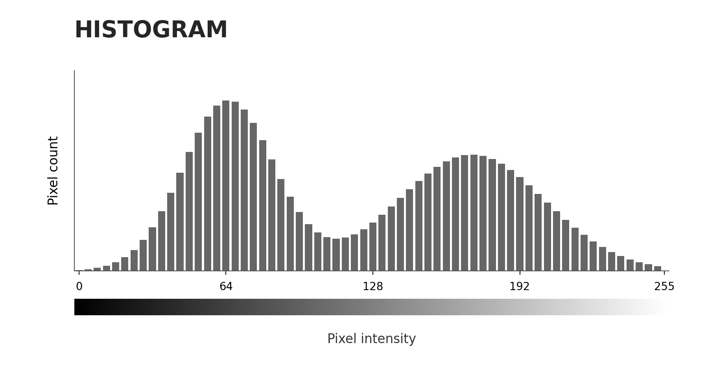
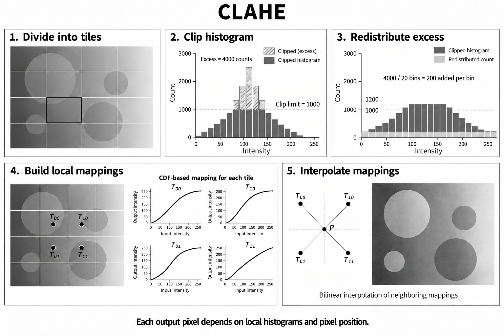

# Histogram-based Image Processing Techniques

{style="display: block; margin: 0 auto; width: 400px"}

## Histogram Stretching

histogram을 통해 contrast를 간단히 향상시키는 방법 

* 입력 영상의 intensity(밝기값) 범위를 더 넓은 범위로 확장하여 contrast(명암 대비)를 향상시키는 방법.
* 기본적인 linear stretching은 최소·최대 intensity를 기준으로 선형 변환하며,
* intensity가 좁은 범위에 집중된 low-contrast 영상에 활용됨.

참고: [Histogram Stretching](https://dsaint31.tistory.com/838)

## Histogram Equalization (Global HE)

histogram을 통해 contrast를 향상시키는 방법 

* 영상 전체의 histogram에서 구한 CDF(Cumulative Distribution Function, 누적분포함수)를 이용하여 intensity를 재분배하고 contrast를 향상시키는 방법임.
* **전체 영상에 동일한(global) 변환을 적용** 하므로 illumination(조명)이 불균일한 영상에서는 일부 영역의 contrast 개선이 제한되거나 noise(잡음)가 강조될 수 있음. 

참고: [Global HE](https://dsaint31.tistory.com/837)

## Contrast Limited Adaptive Histogram Equalization (CLAHE)

{style="display:block; margin: 0 auto; width: 500px"}

histogram을 통해 contrast를 local 별로 adaptive 하게 향상시키는 방법  
(조명이 불균일한 경우 포함)

* 영상을 작은 tile(영역, patch)로 나누어 각 영역의 histogram을 이용하므로, **illumination이 불균일한 경우** 에도 [local contrast(국소 명암 대비)](https://dsaint31.tistory.com/354)를 개선할 수 있는 방법임.
* Histogram의 큰 bin 값을 clip limit으로 제한하고 초과분을 재분배하여 과도한 contrast 및 noise 증폭을 억제하며,
* 인접 영역의 변환 결과를 interpolation(보간)하여 경계의 불연속을 줄임.

참고: [CLAHE](https://dsaint31.tistory.com/836)

## Histogram Matching

원하는 histogram이 되도록 입력이미지를 변경처리하는 방법.

* 입력 영상의 histogram이 지정된 target histogram(목표 히스토그램)에 가까워지도록 intensity를 변환하는 방법
* Histogram Specification이라고도 불림.
* Reference image(참조 영상)의 histogram을 target으로 사용하여 서로 다른 영상의 밝기 및 contrast 분포를 유사하게 조정하는 데 활용됨.

참고: [Histogram Matching](https://dsaint31.tistory.com/835)

## Histogram Backprojection

histogram을 일종의 feature로 삼아서 이를 통해 **image segmentation** 을 수행.

* 관심 대상의 intensity 또는 color histogram을 feature(특징)로 사용하여,
* 입력 영상의 각 pixel에 해당 histogram bin의 값을 대응시키는 방법임.
* 이렇게 얻은 response map(응답 맵)에서 값이 큰 영역을 선택하여 관심 대상의 위치 탐색이나 image segmentation(영상 분할)에 활용함.

참고: [Histogram Backprojection](https://dsaint31.me/mkdocs_site/DIP/cv2/ch02/dip_histogram_backprojection/)

## Histogram based Thresholding

* 영상의 intensity histogram을 분석하여 threshold(임계값)를 결정하고, 이를 기준으로 object(대상)와 background(배경)를 분리하는 방법임.
* 대상의 면적 비율을 이용하는 p-tile,
* histogram peak 사이의 valley를 이용하는 mode,
* between-class variance(클래스 간 분산)를 최대화하는 Otsu Thresholding 등이 있음.

참고: [p-tile, mode, Otsu Thresholding](https://dsaint31.me/mkdocs_site/DIP/cv2/ch02/dip_thresholding/#histogram-based-thresholding)
