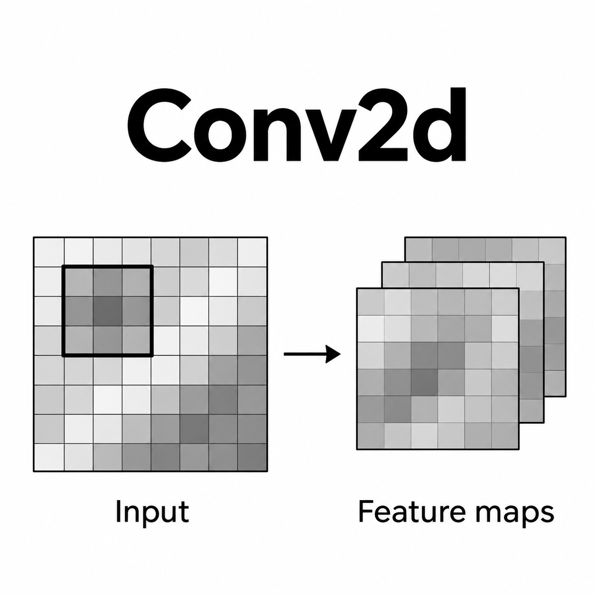

# PyTorch의 `nn.Conv2d` 사용법

{style="display: block; margin: 0 auto; width: 400px"}

**`nn.Conv2d`는 image나 feature map에 2D convolution (2차원 합성곱)을 적용하는 layer임.**

- 입력의 국소 영역에 kernel을 적용하여 feature map을 생성함.
- Kernel의 weight와 bias는 학습 과정에서 조정됨.
- 엄밀한 연산은 kernel을 뒤집지 않는 **Cross-correlation (상호상관)** 임.

## 1. 기본 사용법과 Tensor Shape

```python
import torch
import torch.nn as nn

conv = nn.Conv2d(
    in_channels=3,
    out_channels=16,
    kernel_size=3,
    padding=1,
)

# RGB image 8장, 각 image의 크기는 32 x 32
x = torch.randn(8, 3, 32, 32)
y = conv(x)

print(x.shape)  # torch.Size([8, 3, 32, 32])
print(y.shape)  # torch.Size([8, 16, 32, 32])
```

위 예제는 **높이와 너비를 유지하면서 channel 수를 3에서 16으로 변경함.**

- `kernel_size=3`: 각 입력 channel에서 `3 x 3` kernel을 사용함.
- `padding=1`: 위, 아래, 왼쪽, 오른쪽에 각각 한 줄씩 추가함.
- 생략한 `stride`와 `dilation`은 기본값인 `1`이 적용됨.
- 생략한 `padding_mode`는 기본값인 `"zeros"`가 적용되어 추가 영역을 0으로 채움.

Batch를 포함한 input과 output의 shape는 다음과 같음:

$$
\begin{aligned}
\mathrm{Input\ shape} &=
(N,C_{\mathrm{in}},H_{\mathrm{in}},W_{\mathrm{in}}) \\
\mathrm{Output\ shape} &=
(N,C_{\mathrm{out}},H_{\mathrm{out}},W_{\mathrm{out}}) \\
\end{aligned}
$$

- **Batch size**
    - $N$: 한 번에 처리하는 sample 수.
- **Channel**
    - $C_{\mathrm{in}}$: Input channel 수.
    - $C_{\mathrm{out}}$: Output channel 수.
- **Spatial size**
    - $H_{\mathrm{in}}, W_{\mathrm{in}}$: 입력의 높이와 너비.
    - $H_{\mathrm{out}}, W_{\mathrm{out}}$: 출력의 높이와 너비.

Batch dimension을 생략한 단일 sample의 입력 shape도 지원됨:

$$\mathrm{Input\ shape} = (C_{\mathrm{in}},H_{\mathrm{in}},W_{\mathrm{in}})$$

Image가 `(H, W, C)` 순서로 저장되어 있다면 다음과 같이 dimension 순서를 변경함:

```python
image = torch.randn(32, 32, 3)

# (H, W, C) -> (C, H, W) -> (N, C, H, W)
x = image.permute(2, 0, 1).unsqueeze(0)

y = conv(x)

print(y.shape)  # torch.Size([1, 16, 32, 32])
```

## 2. 주요 Parameter

**Default (기본값)는 해당 parameter를 생략했을 때 자동으로 적용되는 값임.**

```python
nn.Conv2d(
    in_channels,
    out_channels,
    kernel_size,
    stride=1,
    padding=0,
    dilation=1,
    groups=1,
    bias=True,
    padding_mode="zeros",
    device=None,
    dtype=None,
)
```

### `in_channels`

입력의 **channel 수** 를 지정함.

- **Default: 없음. 반드시 지정해야 함.**
- RGB image는 `3`, grayscale image는 `1`로 설정함.
- 이전 layer의 출력을 받는 경우, 해당 출력의 channel 수와 일치해야 함.

### `out_channels`

출력의 **channel 수**, 즉 생성할 feature map 수를 지정함.

- **Default: 없음. 반드시 지정해야 함.**
- `out_channels=16`이면 출력 channel이 16개가 됨.
- 입력과 출력의 channel 수가 같을 필요는 없으나, `groups` 를 지정시 정해진 규칙을 만족해야 함.

### `kernel_size`

**Kernel의 높이와 너비** 를 지정함.

- **Default: 없음. 반드시 지정해야 함.**
- `kernel_size=3`: `3 x 3` kernel.
- `kernel_size=(3, 5)`: 높이 3, 너비 5인 kernel.

### `stride`

**Kernel 적용 위치의 이동 간격** 을 지정함.

- **Default: `1`.**
- `stride=1`: 높이와 너비 방향으로 한 칸씩 이동함.
- `stride=2`: 높이와 너비 방향으로 두 칸씩 이동함.
- `stride=(2, 1)`: 높이 방향으로 두 칸, 너비 방향으로 한 칸씩 이동함.

Stride를 늘리면 출력을 계산하는 위치가 줄어들어 **spatial size (높이와 너비)를 줄일 수 있음.**

### `padding`

입력의 **경계에 추가할 padding의 양** 을 지정함.

- **Default: `0`. Padding을 추가하지 않음.**
- 수치로 지정하는 경우:
    - `padding=1`: 위, 아래, 왼쪽, 오른쪽에 각각 한 줄씩 추가함.
    - `padding=(1, 2)`: 위아래에 각각 한 줄, 좌우에 각각 두 줄씩 추가함.
- 문자열로 지정하는 경우:
    - `padding="valid"`: Padding을 추가하지 않음. `padding=0`과 동일함.
    - `padding="same"`: 출력의 높이와 너비가 입력과 같도록 padding을 추가함. `stride=1`에서만 지원됨.

**추가 영역은 기본적으로 0으로 채워지며**, 다른 방식을 사용하려면 `padding_mode`를 지정함.

### `dilation`

**Kernel 내부에서 참조하는 입력 위치 사이의 간격** 을 지정함.

- **Default: `1`.**
- `dilation=1`: 이웃한 위치를 연속해서 참조함.
- `dilation=2`: 한 칸씩 건너뛰어 참조함.
- `dilation=(2, 1)`: 높이 방향으로는 한 칸씩 건너뛰고, 너비 방향으로는 연속해서 참조함.

**Kernel의 weight 수를 늘리지 않고 receptive field (수용 영역)를 넓혀**, 더 넓은 범위의 정보를 활용하는 데 사용됨.

- **Stride**: Kernel 전체의 이동 간격.
- **Dilation**: Kernel 내부의 참조 간격.

### `groups`

**Input과 output channel의 연결을 나누는 group 수** 를 지정함.

- **Default: `1`.**
- `groups=1`: 모든 input channel을 각 output channel 계산에 사용함.
- `groups=2`: Input과 output channel을 각각 두 group으로 나누고, 대응하는 group끼리만 연결함.
- `groups=in_channels`: 각 input channel을 독립적으로 처리하는 **Depthwise convolution**에 사용함.

**`in_channels`와 `out_channels`는 모두 `groups`로 나누어떨어져야 함.**

### `bias`

각 output channel에 **학습 가능한 bias를 더할지** 지정함.

- **Default: `True`.**
- `bias=True`: Output channel마다 bias 하나를 사용함.
- `bias=False`: Bias를 사용하지 않음.

### `padding_mode`

**Padding으로 추가한 영역을 채우는 방식** 을 지정함.

- **Default: `"zeros"`.**
- 지원하는 방식:
    - `"zeros"`: 추가 영역을 0으로 채움.
    - `"reflect"`: 경계의 값을 거울처럼 반사하여 채움. 경계 값 자체는 반복하지 않음.
    - `"replicate"`: 가장 가까운 경계 값을 반복하여 채움.
    - `"circular"`: 반대쪽 경계의 값을 가져와 순환하도록 채움.

**`padding`은 추가할 양을, `padding_mode`는 채우는 방식을 결정함.**  
따라서 `padding_mode="zeros"`가 기본값이어도 `padding=0`이면 padding이 추가되지 않음.

### `device`

Layer의 **weight와 bias를 생성할 device** 를 지정함.

- **Default: `None`. PyTorch의 기본 device 설정을 따름.**
- 별도의 기본 device 설정이 없다면 CPU에 생성됨.
- `device="cuda"`로 지정하면 CUDA GPU에 생성됨.

입력 tensor와 layer의 parameter는 같은 device에 있어야 함.

### `dtype`

Layer의 **weight와 bias의 data type** 을 지정함.

- **Default: `None`. PyTorch의 기본 floating-point dtype을 따름.**
- 별도의 기본 dtype 설정이 없다면 `torch.float32`로 생성됨.
- `dtype=torch.float64` 등으로 직접 지정할 수 있음.

## 3. 출력 크기 계산과 다양한 Convolution 구현

### 3.1. 출력 크기와 Spatial Size 유지

#### Effective Kernel Size

Dilation을 반영하여 kernel이 입력에서 참조하는 범위를  
**Effective kernel size (유효 kernel 크기)** 로 나타낼 수 있음.  
한 방향의 유효 kernel 크기는 다음과 같음:

$$K_{\mathrm{eff}}=D(K-1)+1$$

- **Kernel size**
    - $K$: 해당 방향의 kernel 크기.
- **Dilation**
    - $D$: 해당 방향의 참조 간격.
- **Effective kernel size**
    - $K_{\mathrm{eff}}$: 첫 참조 위치부터 마지막 참조 위치까지의 범위 크기.

예를 들어 `kernel_size=3`, `dilation=2`이면 유효 kernel 크기는 5임.  
즉, 각 입력 channel에서 `3 x 3`개의 weight를 사용하면서 `5 x 5` 범위에 걸친 위치를 참조함.

#### 출력 크기 공식

출력의 높이와 너비는 **입력 크기, kernel size, stride, padding, dilation** 에 따라 결정됨.  
Dilation까지 반영한 출력 크기 공식은 다음과 같음:

$$\begin{aligned}H_{\mathrm{out}} &=
\left\lfloor
\frac{
H_{\mathrm{in}}+2P_h-D_h(K_h-1)-1
}{
S_h
}
\right\rfloor+1 \\
W_{\mathrm{out}} &=
\left\lfloor
\frac{
W_{\mathrm{in}}+2P_w-D_w(K_w-1)-1
}{
S_w
}
\right\rfloor+1 \end{aligned}
$$

- **Input size**
    - $H_{\mathrm{in}}$: 입력의 높이.
    - $W_{\mathrm{in}}$: 입력의 너비.
- **Output size**
    - $H_{\mathrm{out}}$: 출력의 높이.
    - $W_{\mathrm{out}}$: 출력의 너비.
- **Kernel size**
    - $K_h$: Kernel의 높이.
    - $K_w$: Kernel의 너비.
- **Stride**
    - $S_h$: 높이 방향의 이동 간격.
    - $S_w$: 너비 방향의 이동 간격.
- **Padding**
    - $P_h$: 위쪽과 아래쪽에 각각 추가하는 padding의 양.
    - $P_w$: 왼쪽과 오른쪽에 각각 추가하는 padding의 양.
- **Dilation**
    - $D_h$: 높이 방향의 kernel 참조 간격.
    - $D_w$: 너비 방향의 kernel 참조 간격.
- **Floor**
    - $\lfloor\cdot\rfloor$: 계산 결과를 내림하여 정수로 만드는 연산.

위 식은 **각 방향의 양쪽에 같은 양의 padding을 추가하는 경우** 에 적용함.  
기본값인 `dilation=1`도 이 식으로 계산 가능함.

#### 설정에 따른 크기 변화

입력이 `32 x 32`, `kernel_size=3`이며, 높이와 너비에 같은 설정을 적용하는 경우임.

- **기본 설정**
    - `stride=1`, `dilation=1`, `padding=0`.
    - 출력 크기: `30 x 30`.
- **Padding을 추가한 경우**
    - `stride=1`, `dilation=1`, `padding=1`.
    - 출력 크기: `32 x 32`.
- **Padding을 유지하면서 dilation을 늘린 경우**
    - `stride=1`, `dilation=2`, `padding=1`.
    - 출력 크기: `30 x 30`.
- **Dilation에 맞춰 padding도 늘린 경우**
    - `stride=1`, `dilation=2`, `padding=2`.
    - 출력 크기: `32 x 32`.
- **Stride를 늘린 경우**
    - `stride=2`, `dilation=1`, `padding=1`.
    - 출력 크기: `16 x 16`.

**Padding을 고정한 상태에서 dilation을 늘리면 출력의 spatial size가 줄어듦.**

#### Spatial Size 유지 조건

Stride가 1이고 양쪽에 같은 양의 padding을 추가하는 경우, 크기 보존 조건은 다음과 같음:

$$2P=D(K-1)$$

- $P$: 해당 방향의 양쪽 경계에 각각 추가하는 padding의 양.
- $D$: 해당 방향의 dilation.
- $K$: 해당 방향의 kernel 크기.

높이와 너비 방향에서 각각 이 조건을 만족해야 함.

Padding을 직접 계산하는 대신 `padding="same"`을 사용할 수도 있음.

- 필요한 경우 양쪽에 다른 양의 padding을 적용함.
- `stride=1`에서만 지원됨.
- 보존되는 것은 높이와 너비이며, channel 수는 `out_channels`로 결정됨.

### 3.2. 다양한 Convolution 구현

#### 3.2.1. 일반적인 Convolution

**`groups=1`에서는 하나의 output channel을 계산할 때 모든 input channel을 사용함.**

```python
conv = nn.Conv2d(
    in_channels=3,
    out_channels=16,
    kernel_size=3,
    padding=1,
)

x = torch.randn(8, 3, 32, 32)
y = conv(x)

print(y.shape)  # torch.Size([8, 16, 32, 32])
```

하나의 output feature map을 생성하는 과정은 다음과 같음:

1. 입력 channel 3개에 각각 대응하는 `3 x 3` kernel을 적용함.
2. 같은 출력 위치에서 각 channel의 계산 결과를 더함.
3. 해당 output channel의 bias를 더함.

입력 channel 전체에 걸친 filter 16개를 사용하여 output channel 16개를 생성함.  
**Input과 output의 channel 수가 같을 필요는 없으며, 서로 정수배일 필요도 없음.**

#### 3.2.2. Grouped Convolution

**Input과 output channel을 여러 group으로 나누고, 대응하는 group끼리만 convolution을 수행하는 방식임.**

- `groups`로 group 수를 지정함.
- `in_channels`와 `out_channels`는 모두 `groups`로 나누어떨어져야 함.
- 같은 channel 수와 kernel size의 일반적인 convolution보다 weight 수와 연산량을 줄일 수 있음.

```python
grouped = nn.Conv2d(
    in_channels=4,
    out_channels=6,
    kernel_size=3,
    padding=1,
    groups=2,
)

x = torch.randn(8, 4, 32, 32)
y = grouped(x)

print(y.shape)  # torch.Size([8, 6, 32, 32])
```

- **첫 번째 group**
  - Input channel `0`, `1`을 사용함.
  - Output channel `0`, `1`, `2`를 생성함.
- **두 번째 group**
  - Input channel `2`, `3`을 사용함.
  - Output channel `3`, `4`, `5`를 생성함.

같은 group 안에서는 입력 channel의 계산 결과를 합치며, 서로 다른 group 사이에서는 값을 섞지 않음.

#### 3.2.3. Depthwise Convolution

**각 input channel에 개별 filter를 적용하는 방식으로, `groups=in_channels`로 구현함.**

```python
depthwise = nn.Conv2d(
    in_channels=16,
    out_channels=16,
    kernel_size=3,
    padding=1,
    groups=16,
)

x = torch.randn(8, 16, 32, 32)
y = depthwise(x)

print(y.shape)  # torch.Size([8, 16, 32, 32])
```

- **입력과 출력의 channel 수가 같은 경우**
  - Input channel 하나당 filter 하나를 적용함.
  - Input channel `0`은 output channel `0`에, input channel `1`은 output channel `1`에 대응하는 순서로 출력이 생성됨.
  - 각 filter는 서로 다른 weight와 bias를 사용함.
- **입력과 출력의 channel 수가 다른 경우**
  - `out_channels`는 `in_channels`의 양의 정수배여야 함.
  - Input channel 하나당 여러 filter를 적용하여 여러 output channel을 생성함.

```python
# Input channel 하나당 filter 두 개 적용
depthwise = nn.Conv2d(
    in_channels=3,
    out_channels=6,
    kernel_size=3,
    padding=1,
    groups=3,
)
```

위 설정의 channel 대응은 다음과 같음:

- Input channel `0`
    - Output channel `0`, `1`을 생성함.
- Input channel `1`
    - Output channel `2`, `3`을 생성함.
- Input channel `2`
    - Output channel `4`, `5`를 생성함.

**각 output channel은 하나의 input channel만 사용하므로 channel 사이의 정보는 결합되지 않음.**  
입출력의 shape가 같더라도 각 channel의 값은 convolution 결과로 변경됨.

`in_channels=3`, `groups=3`, `out_channels=5`처럼 설정하면 나누어떨어지지 않아 오류가 발생함.

#### 3.2.4. Dilated Convolution

**Kernel 내부의 참조 간격을 넓혀 더 넓은 입력 영역을 활용하는 방식으로, `dilation`을 1보다 크게 설정하여 구현함.**

```python
dilated = nn.Conv2d(
    in_channels=3,
    out_channels=16,
    kernel_size=3,
    dilation=2,
    padding=2,
)

x = torch.randn(8, 3, 32, 32)
y = dilated(x)

print(y.shape)  # torch.Size([8, 16, 32, 32])
```

- **`kernel_size=3`, `dilation=2`**
    - 각 입력 channel에서 `3 x 3`개의 weight를 사용함.
    - 입력 위치를 한 칸씩 건너뛰어 참조하여 전체 참조 범위는 `5 x 5`가 됨.
- **`padding=2`**
    - 넓어진 참조 범위에 맞춰 padding을 추가하여 높이와 너비를 유지함.

**Weight 수를 늘리지 않고 receptive field를 넓히는 데 사용됨.**

#### 3.2.5. 1 x 1 Convolution

**각 spatial 위치에서 channel 방향의 정보를 결합하는 방식으로, `kernel_size=1`, `groups=1`로 구현함.**  
Pointwise convolution이라고도 함.

```python
pointwise = nn.Conv2d(
    in_channels=16,
    out_channels=32,
    kernel_size=1,
)

x = torch.randn(8, 16, 32, 32)
y = pointwise(x)

print(y.shape)  # torch.Size([8, 32, 32, 32])
```

- **Spatial 방향**
  - 각 위치에서만 계산하며, 주변 위치의 값은 참조하지 않음.
  - 위 예제의 기본 `stride=1`, `padding=0`에서는 높이와 너비가 유지됨.
- **Channel 방향**
  - 같은 위치에 있는 input channel 16개의 값을 학습 가능한 weight로 결합함.
  - Output channel 32개를 생성함.

**Channel 수를 줄이거나 늘리는 용도 및 channel 사이의 정보를 결합하는 용도로 사용됨.**

#### 3.2.6. Depthwise Separable Convolution

**Depthwise convolution과 `1 x 1` pointwise convolution을 순서대로 적용하는 방식임.**

```python
depthwise_separable = nn.Sequential(
    nn.Conv2d(
        in_channels=16,
        out_channels=16,
        kernel_size=3,
        padding=1,
        groups=16,
    ),
    nn.Conv2d(
        in_channels=16,
        out_channels=32,
        kernel_size=1,
    ),
)

x = torch.randn(8, 16, 32, 32)
y = depthwise_separable(x)

print(y.shape)  # torch.Size([8, 32, 32, 32])
```

- **Depthwise convolution**
    - 각 channel에서 spatial 정보를 처리함.
- **Pointwise convolution**
    - Channel 사이의 정보를 결합하고 output channel 수를 결정함.

Spatial 처리와 channel 결합을 나누어 구현하여 **일반적인 convolution보다 weight 수와 연산량을 줄이는 데 사용됨.**

### 3.3. Weight와 Bias의 Shape 및 Parameter 수

Weight의 shape는 다음과 같음:

$$\mathrm{Weight\ shape} =
\left(
C_{\mathrm{out}},
\frac{C_{\mathrm{in}}}{G},
K_h,
K_w
\right)
$$

- **Channel**
    - $C_{\mathrm{in}}$: Input channel 수.
    - $C_{\mathrm{out}}$: Output channel 수.
- **Groups**
    - $G$: Channel 연결을 나누는 group 수.
- **Kernel size**
    - $K_h$: Kernel의 높이.
    - $K_w$: Kernel의 너비.

Bias를 사용하면 output channel마다 하나씩 생성됨.

```python
conv = nn.Conv2d(3, 16, kernel_size=3)

print(conv.weight.shape)  # torch.Size([16, 3, 3, 3])
print(conv.bias.shape)    # torch.Size([16])
```

전체 학습 parameter 수는 다음과 같음:

$$
N_{\mathrm{param}} = C_{\mathrm{out}}
\frac{C_{\mathrm{in}}}{G}
K_hK_w +
\begin{cases}
C_{\mathrm{out}}, & \text{bias=True},\\
0, & \text{bias=False}.
\end{cases}
$$

- $N_{\mathrm{param}}$: 전체 학습 parameter 수.
- 첫 번째 항: Weight 수.
- 두 번째 항: Bias 수.

위 예제에서는 weight 432개와 bias 16개를 사용함.

```python
print(sum(p.numel() for p in conv.parameters()))  # 448
```

## 4. Activation Function과 함께 사용

**`nn.Conv2d` 자체에는 activation function (활성화 함수)이 포함되어 있지 않음.**  
ReLU 등을 적용하려면 별도의 layer로 추가함.

```python
model = nn.Sequential(
    nn.Conv2d(
        in_channels=3,
        out_channels=16,
        kernel_size=3,
        padding=1,
    ),
    nn.ReLU(),

    nn.Conv2d(
        in_channels=16,
        out_channels=32,
        kernel_size=3,
        stride=2,
        padding=1,
    ),
    nn.ReLU(),
)

x = torch.randn(8, 3, 32, 32)
y = model(x)

print(y.shape)  # torch.Size([8, 32, 16, 16])
```

- **첫 번째 `Conv2d`**
    - Spatial size를 `32 x 32`로 유지함.
    - Channel 수를 `3`에서 `16`으로 변경함.
- **두 번째 `Conv2d`**
    - Spatial size를 `16 x 16`으로 줄임.
    - Channel 수를 `16`에서 `32`로 변경함.
- **각 `ReLU`**
    - Activation을 적용함.
    - Tensor shape는 유지함.

연속된 convolutional layer에서는 **앞 layer의 `out_channels`와 다음 layer의 `in_channels`가 일치해야 함.**  
실제 입력 tensor의 channel 수가 `in_channels`와 다르면 오류가 발생함.
