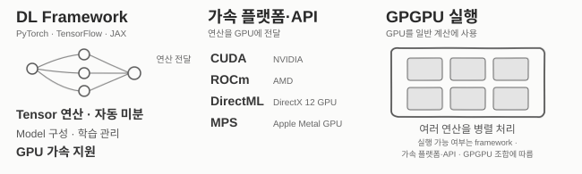

# DL Framework와 GPGPU 가속 기술

## 1. DL Framework

**DL Framework** 는  
Tensor 연산과 자동 미분을 핵심 기반으로 하며,  
이를 토대로 neural network model 구성과 학습 기능을 제공하는 software임.

### 핵심 기능

- **Tensor 연산**: 다차원 배열의 연산을 지원함.
- **자동 미분**: 계산 결과에 대한 gradient를 구함.

### DL 지원 기능

- **GPU 가속**: 지원되는 backend를 통해 Tensor 연산을 GPU에서 실행함.
- **Model 구성·관리**: layer를 연결하여 neural network model을 정의하고 관리함.
- **학습 관리**: loss와 optimizer를 이용해 parameter를 업데이트함.
- **예**: PyTorch, TensorFlow, JAX.

## 2. GPGPU 가속 플랫폼·API

**GPGPU** 는 GPU를 그래픽 처리뿐 아니라 일반 계산에도 사용하는 방식임.  
AI 가속 플랫폼·API는 DL Framework의 연산을 GPU에서 실행하도록 지원함.

- **CUDA**: NVIDIA GPU의 general-purpose 연산을 위한 computing platform 및 programming model임.
- **ROCm**: AMD GPU용 runtime, compiler, library 등을 포함하는 software stack임.
- **DirectML**: DirectX 12 호환 GPU에서 Machine Learning 연산을 실행하는 API임.
- **MPS**: Apple의 Metal 기반 GPU 연산 framework로, Apple GPU에 최적화된 compute kernel을 제공함.

## 3. DL Framework와 가속 기술의 관계

- **DL Framework** 는 model을 구성하고 학습을 관리함.
- **가속 플랫폼·API** 는 DL Framework의 연산을 GPU에서 실행하도록 지원함.
- 예를 들어 PyTorch로 model을 학습할 때, PyTorch는 학습 과정을 관리하고 CUDA 또는 MPS는 GPU 연산을 지원함.

## DL Framework의 역사

2026년 이 글 작성 당시 주로 개발 및 사용되는 DL Framework는 다음과 같음:

* PyTorch
* TensorFlow
* JAX

등장 연도순으로, 개발을 주도한 기관과 특징을 간단히 정리하면 다음과 같음:

- **2007 — Theano**:
    - Université de Montréal의 LISA 연구실(현재 Mila)이 주도
    - Python에서 수학 연산을 정의하고 자동 미분과 GPU 실행을 지원한 초기 framework임.
- **2011 — Torch7**:
    - Torch라고도 불리며 Idiap Research Institute와 NYU 연구자들이 개발을 주도
    - Lua 기반의 tensor 연산과 GPU 계산을 제공함.
- **2014 — Caffe**:
    - UC Berkeley의 Berkeley Vision and Learning Center(BVLC)가 주도
    - CNN의 빠른 학습과 배포에 초점을 둔 C++ framework임.
- **2015 — Keras**:
    - Google의 François Chollet이 공개
    - High-level API로 neural network를 간결하게 구성하도록 설계됨.
    - Keras 1은 Theano, TF 등을 backend로 지원, Keras 2는 TF만, Keras 3는 PyTorch, TF, JAX를 backend로 지원.
- **2015 — Chainer**:
    - 일본의 Preferred Networks와 Preferred Infrastructure가 개발
    - Python 코드 실행 중 계산 그래프를 구성하는 *Define-by-Run* 방식을 채택함.
- **2015 — MXNet**:
    - DMLC(Distributed Machine Learning Community)가 개발을 주도
    - 효율적인 분산 학습과 symbolic 연산·tensor 연산의 결합을 지원함.
- **2015 — TensorFlow**:
    - Google이 개발(Theano에 영향을 받은 것으로 알려짐).
    - 연구와 production 환경에서 다양한 장치 및 대규모 분산 학습을 지원하도록 설계됨.
    - 배포 등에서 강점을 지님.
- **2016 — PyTorch**:
    - Facebook AI Research(FAIR)가 개발
    - Python의 명령형 실행 방식과 autograd(자동 미분)을 결합
    - model 작성과 디버깅이 편하기 때문에 현재 LLM 개발에선 거의 표준으로 사용됨.
    - Torch의 영향을 받았고, Caffe와 Chainer 등의 특징도 가지고 있음.
- **2018 — JAX**:
    - Google Brain 연구진이 공개
    - JAX: 사용자가 작성한 Python 수치 계산 함수에
    - `grad`, `vmap`, `jit`을 적용해
    - autograd, vectorization, JIT compilation 실행을 하도록 변환하는 library임.
